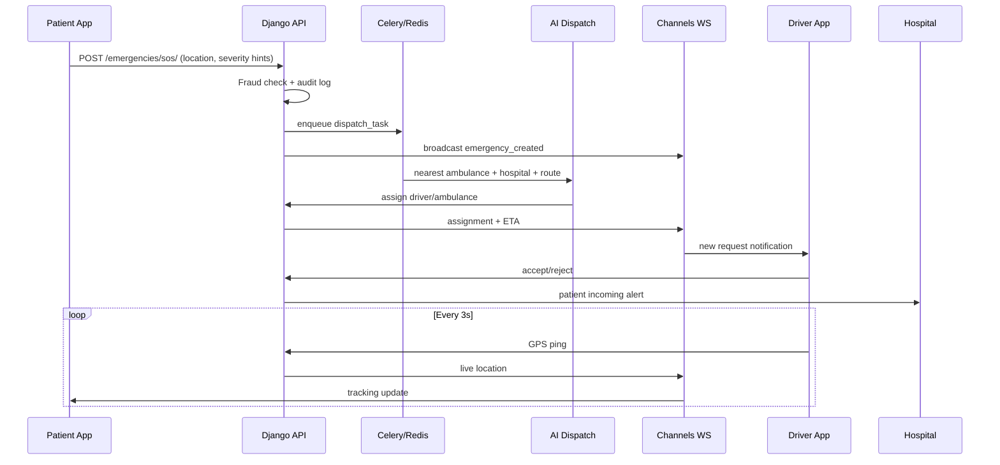

# System Architecture

## Design Principles

1. **Multi-tenant** — Every hospital/org is a tenant; data isolated via `tenant_id`.
2. **Microservice-ready** — AI, notifications, and payments are separate Django apps with clear boundaries; can extract to services later.
3. **Event-driven emergencies** — SOS creates domain events → Celery dispatch → WebSocket broadcast.
4. **Security-first** — E2E for PHI; JWT short-lived; audit everything.

## Service Boundaries (Future Microservices)

| Module | Current Location | Extract Target |
|--------|------------------|----------------|
| Core API | `backend/config` | api-gateway |
| Emergencies | `apps/emergencies` | emergency-service |
| Dispatch AI | `apps/ai/dispatch` | ai-dispatch-service |
| Real-time | `apps/realtime` | websocket-service |
| Notifications | `apps/notifications` | notification-service |
| Payments | `apps/payments` | payment-service |
| OTA | `apps/ota` | ota-service |

## Data Flow: SOS Emergency

## Database Schema (Core Entities)

- **Tenant** — Hospital org / city operator
- **User** — Custom user with role + tenant FK
- **Driver**, **Ambulance**, **Hospital**
- **EmergencyRequest** — Full lifecycle (pending → dispatched → en_route → arrived → completed)
- **EmergencyContact**, **GPSLog**, **Payment**, **Notification**
- **DeviceSession**, **AuditLog**, **AIAnalytics**, **OTAUpdate**

## Encryption

| Layer | Method |
|-------|--------|
| Transport | TLS 1.3 (Nginx) |
| API tokens | JWT RS256 (configurable HS256 dev) |
| Medical chat | NaCl box (per-conversation keys in client) |
| Cloud files | AES-256 server-side + client E2E optional |
| Super Admin | Localhost bind + `ADMIN_PANEL_SECRET` header |

## Offline Mode

1. Client queues SOS in SQLite (Flutter).
2. On connectivity: sync to `/api/v1/emergencies/offline-sync/`.
3. Fallback: Twilio SMS webhook → creates emergency stub.

## Observability

- **Sentry** — API + web + Flutter
- **Firebase Crashlytics** — Mobile
- **Structured logs** — JSON to stdout (CloudWatch/Datadog compatible)
- **Prometheus metrics** — `/metrics/` (optional middleware)

## Deployment (AWS/GCP/Azure)

- **ECS/Cloud Run/AKS** — API + worker containers
- **RDS/Cloud SQL** — PostgreSQL with automated backups
- **ElastiCache/Memorystore** — Redis
- **S3/GCS/Blob** — Media + encrypted backups
- **Auto-scaling** — HPA on CPU + custom metric `active_emergencies`

## Super Admin Panel

Runs **only on localhost** (`127.0.0.1:5173`). Requires:
- VPN or SSH tunnel in production ops
- `X-Admin-Panel-Key` encrypted challenge
- Separate from public API surface
